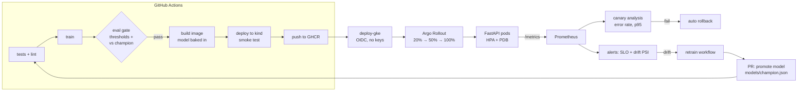

# production-ml-platform

[](https://github.com/shohanursobuj/production-ml-platform/actions/workflows/ci.yml)

A small but complete reference for running an ML model in production: **train → evaluation gate → container → Kubernetes (canary) → metrics & SLO alerts → drift detection → retraining → reviewed promotion.**

The model is deliberately simple (TF-IDF + logistic regression sentiment classifier on Rotten Tomatoes reviews) so the repo stays fast to run and CI stays cheap. Everything around the model is what this project is about, and swapping in a transformer or an LLM call does not change the platform.



## What's in here

| Concern | Implementation | Where |
|---|---|---|
| Reproducible training | Pinned deps, fixed params, artifact bundles pipeline + version + drift reference | `src/mlplatform/train.py` |
| Experiment tracking | MLflow logging when `MLFLOW_TRACKING_URI` is set; MLflow server in the local stack | `train.py`, `docker-compose.yml` |
| Evaluation gate | Absolute floors (accuracy, ROC-AUC), latency ceiling, max regression vs. current champion | `src/mlplatform/evaluate.py` |
| Serving | FastAPI, batch endpoint, input validation, liveness/readiness probes, non-root, read-only FS | `src/mlplatform/serve/app.py`, `Dockerfile` |
| Observability | Prometheus metrics: request/status counts, latency histogram, prediction mix, model version, drift PSI. Grafana dashboard provisioned | `monitoring/` |
| SLOs & alerting | Error rate > 1%, p95 > 50 ms, PSI > 0.2, prediction-mix shift, shared between local Prometheus and k8s `PrometheusRule` | `monitoring/alerts.yml` |
| Drift detection | Population Stability Index on input length and score distribution, rolling window vs. training reference | `src/mlplatform/drift.py` |
| Kubernetes | Helm chart: Deployment or Argo Rollout, HPA, PDB, ServiceMonitor, PrometheusRule, hardened pod security | `deploy/helm/ml-api/` |
| Progressive delivery | Canary steps gated by Prometheus analysis (error rate, p95), automatic abort/rollback | `templates/rollout.yaml` |
| Infrastructure as code | GKE Autopilot, Artifact Registry, keyless GitHub OIDC → Workload Identity, region `europe-west3` (EU data residency) | `infra/terraform/` |
| CI/CD | Lint/test → train → gate → Helm & Terraform validation → real deploy into a kind cluster → publish image | `.github/workflows/ci.yml` |
| Continuous training | Weekly / manual / drift-triggered retrain; promotion is a pull request, so every model change is reviewed and in git history | `.github/workflows/retrain.yml` |

## Results

Held-out Rotten Tomatoes test split (1,066 reviews); hyperparameters picked on the validation split only.

| Metric | Value | Gate |
|---|---|---|
| Accuracy | 0.791 | ≥ 0.77 |
| ROC-AUC | 0.878 | ≥ 0.85 |
| p95 single-request inference | ~0.3 ms (laptop CPU) | ≤ 10 ms |

Drift detection on live traffic (`scripts/loadgen.py`, window of 500 requests):

| Traffic | PSI text_length | PSI positive_score |
|---|---|---|
| Replayed held-out reviews | 0.02 (stable) | 0.02 |
| Same reviews pasted 3× ("upstream started sending whole documents") | **3.1 → FeatureDrift alert** | 0.03 |

The second row is the interesting one: the model's output distribution barely moved, so accuracy-style dashboards would look healthy, while its inputs no longer resemble the training data. Monitoring inputs catches this; monitoring outputs alone does not.

## Run it

```bash
make install          # venv + dependencies
make test             # 13 tests, offline, ~1s
make train && make gate

make up               # API :8080 · MLflow :5000 · Prometheus :9090 · Grafana :3000 (needs Docker)
make loadgen          # normal traffic
make drift-demo       # shifted traffic → PSI climbs, FeatureDrift alert fires in Prometheus
```

Track runs in MLflow: `pip install -r requirements/tracking.txt` then `MLFLOW_TRACKING_URI=http://localhost:5000 make train`.

```bash
curl -s localhost:8080/predict -H 'Content-Type: application/json' \
  -d '{"texts": ["a warm, funny and beautifully made film"]}'
# {"model_version":"202610081757-a1b2c3d","predictions":[{"label":"positive","score":0.9525}]}
```

### Deploy to GCP

```bash
cd infra/terraform
terraform init -backend-config="bucket=<state-bucket>"
terraform apply -var project_id=<project>
```

Set the outputs as repository variables (`GCP_PROJECT`, `GCP_WORKLOAD_IDENTITY_PROVIDER`, `GCP_DEPLOYER_SA`), install [kube-prometheus-stack](https://github.com/prometheus-community/helm-charts/tree/main/charts/kube-prometheus-stack) and [Argo Rollouts](https://argo-cd.readthedocs.io/projects/rollouts/) into the cluster, then run the **deploy-gke** workflow with an image tag from CI.

## Design decisions

- **Model baked into the image.** An image tag identifies exactly one model version, so rollback is just a tag change and pods start without a model download. Downside: images are rebuilt per model. For multi-GB models I'd mount from a registry/GCS with a version pin instead.
- **Gate compares against the champion, not just fixed thresholds.** Thresholds stop disasters; the champion comparison stops slow erosion. A small tolerance (0.01) avoids blocking on noise.
- **Promotion through a PR.** Retraining never ships on its own. It opens a PR that updates `models/champion.json` with the gate output in the description. Reviewable, revertable, auditable.
- **Drift = PSI on simple features.** Cheap enough to compute in-process on every request, no extra service. PSI > 0.2 is the conventional "significant shift" line. A heavier setup would sample requests to a store and run Evidently/whylogs offline.
- **Canary analysis on SLO metrics.** The rollout only progresses if error rate and p95 latency on Prometheus stay within budget; otherwise Argo aborts and rolls back with no human in the loop.
- **Keyless CI → cloud.** GitHub OIDC + Workload Identity Federation, restricted to this repo's `main` branch. No service-account JSON keys anywhere.

## Runbook

| Alert | First checks | Typical action |
|---|---|---|
| **HighErrorRate** (page) | `kubectl logs -l app.kubernetes.io/name=ml-api`; was there a rollout in the last hour? | `kubectl argo rollouts undo ml-api -n ml` (or `helm rollback`) |
| **HighInferenceLatency** | Grafana latency panel vs. request rate; HPA at max replicas? CPU throttling? | Raise HPA max / CPU requests; check batch sizes from clients |
| **FeatureDrift** | Which feature? Compare live vs. reference in Grafana; talk to the upstream team: did the input source change? | If the change is legitimate: label fresh data and trigger **retrain**. If it's a bug upstream: fix there, no retrain |
| **PredictionMixShift** | Real-world change or broken input (e.g. empty strings)? Sample recent requests | Same as FeatureDrift |

## Repository layout

```
src/mlplatform/      train.py · evaluate.py · drift.py · data.py · serve/app.py
tests/               unit + API tests on synthetic data (no network)
monitoring/          prometheus.yml · alerts.yml · grafana/ (provisioned dashboard)
deploy/helm/ml-api/  Deployment | Rollout, HPA, PDB, ServiceMonitor, PrometheusRule
infra/terraform/     GKE Autopilot, Artifact Registry, GitHub OIDC
.github/workflows/   ci · retrain · deploy-gke
models/champion.json metrics of the model currently in production
```

## Scope and limits

This is a reference project, not a running production service. CI really does run the training, the gate, Helm/Terraform validation and a deploy into a kind cluster on every push. The GKE + Argo Rollouts path needs a GCP project to run. The drift → retrain hop needs a small relay from Alertmanager to GitHub's `repository_dispatch` API, which is not included. The training data is a static public dataset; in production `data.load_split` would read freshly labelled data, which is what makes retraining meaningful.

---

Built by [Md Shohanur Islam Sobuj](https://shohanursobuj.dev), ML engineer in Köln.
